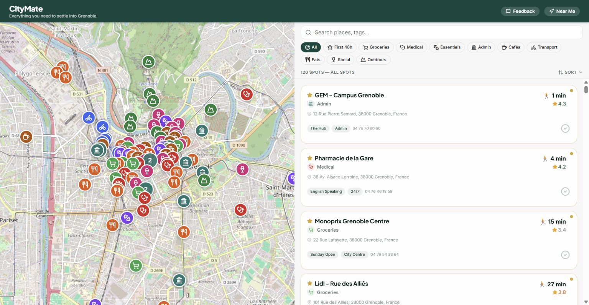

# CityMate Grenoble

CityMate is a mobile-first guide for students and other newcomers settling into Grenoble, France. It brings everyday essentials such as grocery stores, pharmacies, and student services into one searchable map. The guide covers **120 curated places across nine categories**.

Dharaneesh Venkatasalamoorthy built CityMate after arriving in Grenoble as an international student and finding that practical information was spread across group chats, maps, and separate websites.

[Explore the live app](https://citymate-grenoble.base44.app/)



Map data © [OpenStreetMap contributors](https://www.openstreetmap.org/copyright).

## Features

- **Map and list views.** Search for places, combine category filters, and sort by distance or rating.
- **First 48h checklist.** Find useful places for your first days in Grenoble and check them off as you go.
- **Near Me.** Use your location to find nearby places. When location is unavailable, distances are estimated from the Grenoble Ecole de Management campus.
- **Place details.** See addresses and directions, with opening hours and contact details where available.
- **Feedback.** Suggest a place, report a correction, or share an idea through the live app.

## First-week launch metrics

CityMate was launched through Grenoble student communities. The live app recorded the following traffic in its first seven days.

| Metric | First seven days |
| --- | ---: |
| Unique visitors | 266 |
| Total visits | 436 |

## Run locally

**Requirements:** Node.js 22.12 or newer, npm, and access to the private place data modules. The public repository excludes the dataset and generated build output.

1. Clone the repository.

   ```sh
   git clone https://github.com/Dharaneesh24/Citymate.git
   cd Citymate
   ```

2. Place the private data modules at `src/lib/placesData.js` and `src/lib/placesRichData.js`.
3. Install dependencies and start the Vite development server.

   ```sh
   npm ci
   npm run dev
   ```

   Open the URL printed in the terminal. To try CityMate without the private data modules, use the [live app](https://citymate-grenoble.base44.app/).

To build and serve a local production copy, run:

```sh
npm run build
npm start
```

The production server listens at [http://127.0.0.1:4173](http://127.0.0.1:4173). OpenStreetMap tiles require internet access. Near Me requires browser location permission. Checklist progress and feedback stay in the browser for the local build, and analytics stay in the current browser session.

## Project structure

The public source uses **React**, **Vite**, **Tailwind CSS**, and **Leaflet** with OpenStreetMap tiles. The live app is hosted on Base44.

| Path | Purpose |
| --- | --- |
| [`src/pages/Home.jsx`](src/pages/Home.jsx) | Directory layout, search, filters, sorting, and checklist state |
| [`src/components/map/`](src/components/map/) | Map, markers, navigation, and place details |
| [`src/components/feedback/`](src/components/feedback/) | Feedback form |
| [`src/api/base44Client.js`](src/api/base44Client.js) | Browser-local feedback and session analytics |
| [`serve.mjs`](serve.mjs) | Local production server |

## Maintainer

[Dharaneesh Venkatasalamoorthy](https://github.com/Dharaneesh24)
